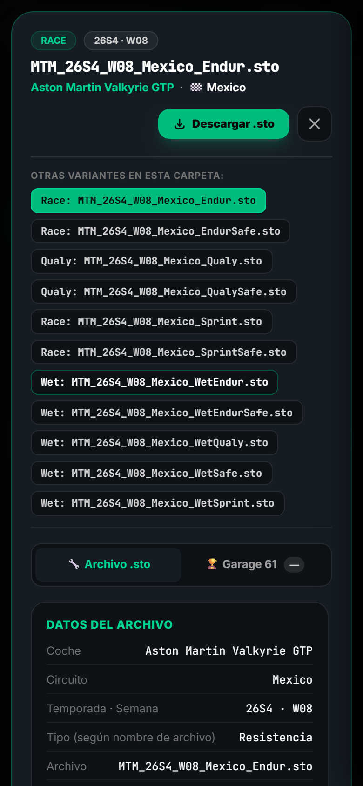

<p align="center">
  
</p>

<h1 align="center">🏁 Muntrume Motorsport</h1>

<p align="center">
  <strong>Portal oficial de escudería, repositorio confidencial de telemetría y setups para iRacing, y cliente corporativo de webmail bajo el ecosistema ATM Software Labs.</strong><br/>
  <em>Official high-performance sim racing portal, encrypted setup vault (196 cars · 239,539 setups), and secure driver communications platform.</em>
</p>

<p align="center">
  <a href="https://muntru.me"><b>muntru.me</b></a> ·
  <a href="https://muntru.me/setups">Setup Vault</a> ·
  <a href="https://muntru.me/mail">Webmail &amp; Comms</a> ·
  <a href="https://muntru.me/news">Sala de Prensa</a> ·
  <a href="https://discord.gg/ehX6B8JUtE">Discord Oficial</a> ·
  <a href="SECURITY.md">Seguridad Blindada</a>
</p>

<p align="center">
  <a href="https://muntru.me"></a>
  <a href="https://trujillomingorance.com"></a>
  <a href="https://antigravity.google"></a>
  
  
  
  
  
</p>

---

## 📸 Capturas del Sistema & Responsive Showcase

### 🖥️ Plataforma de Escritorio
<p align="center">
  
  <br/>
  <em>Setup Vault: Catálogo de 196 vehículos, 239.539 configuraciones .STO y sincronización directa con carpetas locales de iRacing.</em>
</p>

<p align="center">
  
  <br/>
  <em>Webmail de Escudería: Comunicaciones internas entre pilotos, relay transaccional verificado y visor de telemetría.</em>
</p>

### 📱 Experiencia Móvil Optimizada (Zero-Overflow)
<p align="center">
  
  &nbsp;&nbsp;
  
  &nbsp;&nbsp;
  
  <br/>
  <em>Diseño adaptativo para smartphones (375px / 390px / 412px): filtros táctiles, navegación con drawer y modal de vista previa técnica.</em>
</p>

---

## ✨ Funciones Clave

- **🏎️ Setup Vault Blindado (196 Coches · 239.539 Setups):**
  - Repositorio privado de alto rendimiento con **196 modelos de iRacing** y **239.539 archivos `.sto`** estandarizados.
  - Firma digital de agua oficial en todas las cabeceras binarias: `muntru.me - Muntrume Motorsport | Setup by Alberto Trujillo`.
  - Integración completa de carpetas históricas y externas de escudería: **ZEK Racing (Garage 61 y FTP)**, `MT_SETUPS` y `OLD_SETUPS` normalizados.
  - Descarga directa en un clic con **File System Access API** a la ruta exacta (`Documents\iRacing\setups\[coche]`).
  - Detección inteligente de dispositivos móviles para descargas directas limpias sin alertas molestas de PC.

- **✉️ Webmail & Telemetry Comms (`/mail`):**
  - Cliente corporativo interno para pilotos, directores deportivos e ingenieros de pista.
  - Identidad de remitente limpia y amigable: `Alberto de Muntrume <alberto.muntrume@trujillomingorance.com>`.
  - Plantillas interactivas de respuesta rápida (*Quick Reply*) para ajustes de telemetría, presiones y directrices de carrera.
  - Enrutamiento bidireccional con Cloudflare Email Routing y parser MIME robusto mediante **`postal-mime`**.
  - Almacenamiento persistente en base de datos Cloudflare D1 (`webmail_messages`).

- **🛡️ Blindaje de Grado Militar (Zero-Trust):**
  - **PBKDF2-SHA256 con 100.000 iteraciones** para derivación criptográfica de contraseñas.
  - Doble factor **2FA One-Time Codes** generados con muestreo aleatorio uniforme y firmas **HMAC-SHA256** (TTL: 10 min).
  - Comparaciones de cadenas en tiempo constante (**`timingSafeEqual`**) contra ataques de canal lateral (*Timing Attacks*).
  - Privacidad estricta por rol: buzones personales aislados (`🔒 PRIVADO`) y panel de administración protegido.
  - Rate limiting estricto: cuotas de 1.500 descargas/hora por piloto y cooldown de 60s en solicitudes 2FA.
  - Cabeceras de seguridad militar: `HSTS` con preload, `X-Frame-Options: DENY`, `X-Content-Type-Options: nosniff`, `Cross-Origin-Opener-Policy: same-origin` y CSP estricto con `frame-ancestors 'none'`.

- **📰 Sala de Prensa & Fichas de Pilotos:** Artículos de competición oficiales, fichas dinámicas `/p/<piloto>` y telemetría de Garage 61.

---

## 🏛️ Stack Técnico

| Capa | Tecnología | Propósito |
| :--- | :--- | :--- |
| **Frontend** | [Astro](https://astro.build) 5.x + [Tailwind CSS](https://tailwindcss.com) 4.x | Generación estática SSG ultra-rápida, diseño dark motorsport y cero sobrecarga de JavaScript. |
| **Edge Compute** | [Cloudflare Workers](https://workers.cloudflare.com) (`worker/index.js`) | API de telemetría, autenticación Zero-Trust, relay transaccional y webhook de Email Workers. |
| **MIME Parsing** | [PostalMime](https://www.npmjs.com/package/postal-mime) | Decodificación y limpieza de correos entrantes multipart, extracción de adjuntos `.sto`. |
| **Base de Datos** | [Cloudflare D1](https://developers.cloudflare.com/d1/) (`muntrume_vault`) | Catálogo de setups, usuarios autorizados, auditoría de descargas y mensajes de buzón. |
| **Email Relay** | Resend API + Cloudflare Email Routing | Despacho y recepción con dominio verificado `trujillomingorance.com` (100% DKIM, SPF y DMARC). |
| **Hosting Web** | GitHub Pages Edge (`CNAME: muntru.me`) | Entrega estática CDN con compresión HTML automática y caché optimizada. |
| **Testing E2E** | [Playwright](https://playwright.dev) (`scripts/test-mobile.mjs`) | Verificación automatizada de responsive móvil, navegación y modales sin errores. |
| **Gobernanza** | [Google Antigravity](https://antigravity.google) (AGY) | Estándares de ingeniería ATM Software Labs, verificación autónoma y tests E2E. |

---

## 🏗️ Arquitectura del Sistema

```
                       ┌───────────────────────────────┐
                       │       https://muntru.me       │
                       │      (GitHub Pages CDN)       │
                       └───────────────┬───────────────┘
                                       │
                         Páginas Estáticas Astro SSG
                 (/, /setups, /mail, /news, /team, /pilotos)
                                       │
                  [ Peticiones REST / JSON-RPC con CORS ]
                                       ▼
                       ┌───────────────────────────────┐
                       │      Cloudflare Worker        │
                       │ (muntrume.atrumin16.workers)  │
                       ├───────────────────────────────┤
                       │  · Setup Vault Auth (PBKDF2)  │
                       │  · 2FA One-Time Codes (HMAC)  │
                       │  · Outbound Relay (Resend)    │
                       │  · Inbound Email Handler      │
                       │    (PostalMime Decoder)       │
                       │  · Blindaje Militar Headers   │
                       └───────┬───────────────┬───────┘
                               │               │
                               ▼               ▼
                     ┌──────────────────┐ ┌───────────────────┐
                     │  Cloudflare D1   │ │ Cloudflare Email  │
                     │ (muntrume_vault) │ │      Routing      │
                     │ · allowed_users  │ │ · Inbound Rules   │
                     │ · setups catalog │ │ · Forward Backup  │
                     │ · webmail_msgs   │ │   to Gmail        │
                     └──────────────────┘ └───────────────────┘
```

---

## 🤖 Gobernanza e Integración con Antigravity

Este repositorio está configurado para desarrollo asistido por **Google Antigravity (AGY)** bajo las normas de ingeniería de **ATM Software Labs**:

1. **`.antigravity/rules.md`**: Define los estándares de arquitectura, cambios quirúrgicos, políticas Zero-Trust y simplicidad técnica.
2. **`.antigravity/config.json`**: Mapea los objetivos de verificación automática (`build`, `test`, `deploy`).
3. **Bucle de Verificación Autónoma:** Todo cambio en el código se valida mediante:
   ```bash
   npm run build && node scripts/test-mobile.mjs
   ```

---

## 🚀 Guía de Desarrollo y Despliegue

### Requisitos Previos
- Node.js `v20+` o `v22+`
- npm `v10+`
- Wrangler CLI (`npx wrangler`) con cuenta autorizada en Cloudflare

### Instalación y Ejecución Local
```bash
# 1. Clonar el repositorio
git clone https://github.com/atrumin16/muntrume-site.git
cd muntrume-site

# 2. Instalar dependencias
npm install

# 3. Compilar estilos y ejecutar servidor de desarrollo
npm run dev

# 4. Compilar para producción (SSG + compresión HTML)
npm run build

# 5. Ejecutar la suite de pruebas E2E móvil automatizada
node scripts/test-mobile.mjs
```

### Despliegue del Backend (Cloudflare Worker)
```bash
cd worker
npx wrangler deploy
```

---

<p align="center">
  <strong>Muntrume Motorsport &copy; 2026</strong> &middot; <em>Sant Andreu, Barcelona 🇪🇸</em><br/>
  Una iniciativa tecnológica desarrollada bajo los estándares de ingeniería de <strong>ATM Software Labs</strong>.<br/>
  <a href="https://muntru.me">muntru.me</a> &bull; <a href="https://trujillomingorance.com">trujillomingorance.com</a>
</p>
