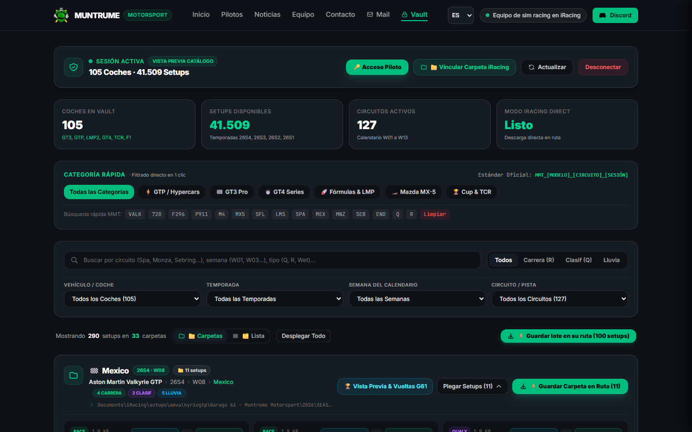
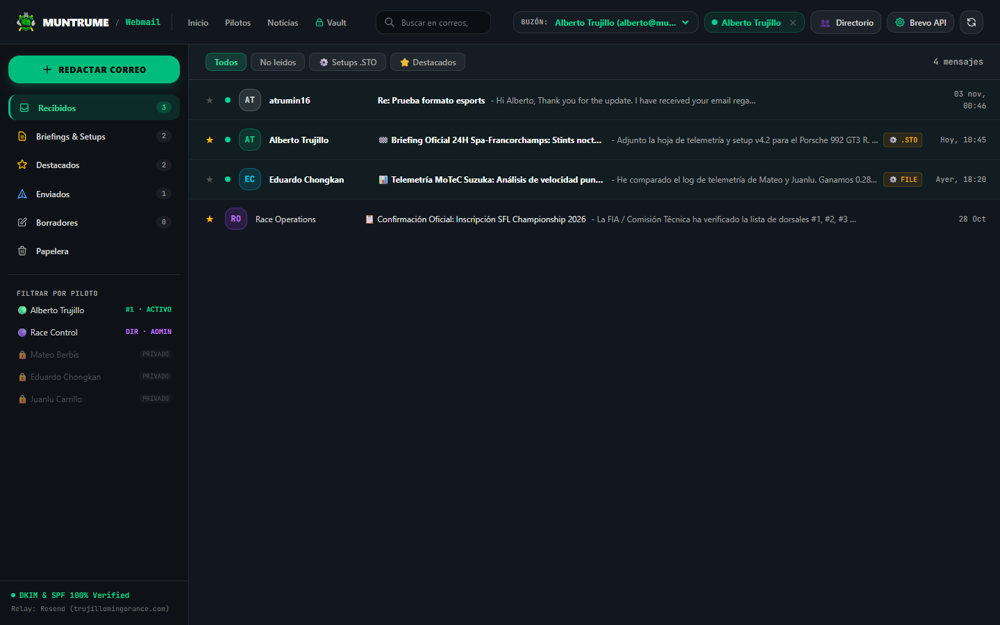

<p align="center">
  
</p>

<h1 align="center">🏁 Muntrume Motorsport</h1>

<p align="center">
  <strong>Portal oficial de escudería, repositorio confidencial de telemetría y setups para iRacing, y cliente corporativo de webmail bajo el ecosistema ATM Software Labs.</strong><br/>
  <em>Official high-performance sim racing portal, encrypted setup vault (105 cars · 41,509 setups), and secure driver communications platform.</em>
</p>

<p align="center">
  <a href="https://muntru.me"><b>muntru.me</b></a> ·
  <a href="https://muntru.me/setups">Setup Vault</a> ·
  <a href="https://muntru.me/mail">Webmail &amp; Comms</a> ·
  <a href="https://muntru.me/news">Sala de Prensa</a> ·
  <a href="https://discord.gg/ehX6B8JUtE">Discord Oficial</a> ·
  <a href="SECURITY.md">Seguridad</a>
</p>

<p align="center">
  <a href="https://muntru.me"></a>
  <a href="https://trujillomingorance.com"></a>
  <a href="https://antigravity.google"></a>
  <a href="https://workers.cloudflare.com"></a>
  <a href="https://astro.build"></a>
  
  
</p>

---

## 📸 Capturas del Sistema

<p align="center">
  
  <br/>
  <em>Setup Vault: Catálogo de 105 vehículos, 41.509 configuraciones .STO y descarga directa a carpetas de iRacing.</em>
</p>

<p align="center">
  
  <br/>
  <em>Webmail de Escudería: Comunicaciones internas entre pilotos, relay verificado y visor de telemetría.</em>
</p>

---

## ✨ Funciones Clave

- **🏎️ Setup Vault Automatizado:** Repositorio privado con **105 coches oficiales y 41.509 setups** clasificados por categoría (GT3, GTP, LMP2, SFL, etc.). Compatible con **File System Access API** para inyección directa de archivos `.sto` en la carpeta `Documents/iRacing/setups/`.
- **✉️ Webmail & Telemetry Comms (`/mail`):**
  - Cliente corporativo interno para pilotos e ingenieros de pista.
  - Identidad de remitente limpia y amigable: `Alberto de Muntrume <alberto.muntrume@trujillomingorance.com>`.
  - Plantillas interactivas de respuesta rápida (*Quick Reply*) para aprobación de telemetría y ajuste de presiones en un clic.
  - Enrutamiento bidireccional con Cloudflare Email Routing y parser MIME robusto mediante **`postal-mime`** (limpieza total de artefactos y formato legible).
  - Almacenamiento persistente en base de datos Cloudflare D1 (`webmail_messages`).
- **🔒 Privacidad Estricta de Piloto:**
  - Control de acceso por rol: cada piloto accede exclusivamente a su buzón personal y a las directrices de Race Control.
  - Los buzones de otros compañeros quedan protegidos y bloqueados con barrera de privacidad `🔒 PRIVADO`.
- **🛡️ Autenticación Zero-Trust Unificada (SSO):**
  - Sesión única compartida entre el Setup Vault y el Webmail.
  - Doble factor 2FA criptográfico con código de 6 dígitos enviado al correo personal del titular (`code/request` y `code/verify`).
  - Verificación de contraseña de alta seguridad mediante algoritmo **PBKDF2-SHA256**.
- **📰 Sala de Prensa & Roster de Pilotos:** Artículos de competición oficiales y fichas técnicas individuales con telemetría integrada de Garage 61.

---

## 🏛️ Stack Técnico

| Capa | Tecnología | Propósito |
| :--- | :--- | :--- |
| **Frontend** | [Astro](https://astro.build) 5.x + [Tailwind CSS](https://tailwindcss.com) 4.x | Generación estática SSG ultra-rápida, diseño dark motorsport y cero sobrecarga de JavaScript. |
| **Edge Compute** | [Cloudflare Workers](https://workers.cloudflare.com) (`worker/index.js`) | API de telemetría, autenticación Zero-Trust, relay transaccional y webhook de Email Workers. |
| **MIME Parsing** | [PostalMime](https://www.npmjs.com/package/postal-mime) | Decodificación y limpieza de correos entrantes multipart, extracción de adjuntos `.sto`. |
| **Base de Datos** | [Cloudflare D1](https://developers.cloudflare.com/d1/) (`muntrume_vault`) | Catálogo de setups, usuarios autorizados, auditoría de descargas y mensajes de buzón. |
| **Email Relay** | Resend API + Cloudflare Email Routing | Despacho y recepción con dominio verificado `trujillomingorance.com` (100% DKIM y SPF). |
| **Hosting Web** | GitHub Pages Edge (`CNAME: muntru.me`) | Entrega estática CDN con compresión HTML automática y caché optimizada. |
| **Gobernanza** | [Google Antigravity](https://antigravity.google) (AGY) | Estándares de ingeniería ATM Software Labs, verificación autónoma y tests E2E. |

---

## 🏗️ Arquitectura del Sistema

```
                       ┌───────────────────────────────┐
                       │       https://muntru.me       │
                       │      (GitHub Pages CDN)       │
                       └───────────────┬───────────────┘
                                       │
                         Páginas Estáticas Astro SSG
                 (/, /setups, /mail, /news, /team, /pilotos)
                                       │
                  [ Peticiones REST / JSON-RPC con CORS ]
                                       ▼
                       ┌───────────────────────────────┐
                       │      Cloudflare Worker        │
                       │ (muntrume.atrumin16.workers)  │
                       ├───────────────────────────────┤
                       │  · Setup Vault Auth (PBKDF2)  │
                       │  · 2FA One-Time Codes (HMAC)  │
                       │  · Outbound Relay (Resend)    │
                       │  · Inbound Email Handler      │
                       │    (PostalMime Decoder)       │
                       └───────┬───────────────┬───────┘
                               │               │
                               ▼               ▼
                     ┌──────────────────┐ ┌───────────────────┐
                     │  Cloudflare D1   │ │ Cloudflare Email  │
                     │ (muntrume_vault) │ │      Routing      │
                     │ · allowed_users  │ │ · Inbound Rules   │
                     │ · setups catalog │ │ · Forward Backup  │
                     │ · webmail_msgs   │ │   to Gmail        │
                     └──────────────────┘ └───────────────────┘
```

---

## 🤖 Gobernanza e Integración con Antigravity

Este repositorio está configurado para desarrollo asistido por **Google Antigravity (AGY)** bajo las normas de ingeniería de **ATM Software Labs**:

1. **`.antigravity/rules.md`**: Define los estándares de arquitectura, cambios quirúrgicos, políticas Zero-Trust y simplicidad técnica.
2. **`.antigravity/config.json`**: Mapea los objetivos de verificación automática (`build`, `test`, `deploy`).
3. **Bucle de Verificación Autónoma:** Todo cambio en el código se valida mediante:
   ```bash
   npm run build && node scripts/e2e-verify.mjs
   ```

---

## 🚀 Guía de Desarrollo y Despliegue

### Requisitos Previos
- Node.js `v20+` o `v22+`
- npm `v10+`
- Wrangler CLI (`npx wrangler`) con cuenta autorizada en Cloudflare

### Instalación y Ejecución Local
```bash
# 1. Clonar el repositorio
git clone https://github.com/atrumin16/muntrume-site.git
cd muntrume-site

# 2. Instalar dependencias
npm install

# 3. Compilar estilos y ejecutar servidor de desarrollo
npm run dev

# 4. Compilar para producción (SSG + compresión HTML)
npm run build

# 5. Ejecutar la suite de pruebas E2E automatizada
node scripts/e2e-verify.mjs
```

### Despliegue del Backend (Cloudflare Worker)
```bash
cd worker
npx wrangler deploy
```

---

<p align="center">
  <strong>Muntrume Motorsport &copy; 2026</strong> &middot; <em>Sant Andreu, Barcelona 🇪🇸</em><br/>
  Una iniciativa tecnológica desarrollada bajo los estándares de ingeniería de <strong>ATM Software Labs</strong>.<br/>
  <a href="https://muntru.me">muntru.me</a> &bull; <a href="https://trujillomingorance.com">trujillomingorance.com</a>
</p>
