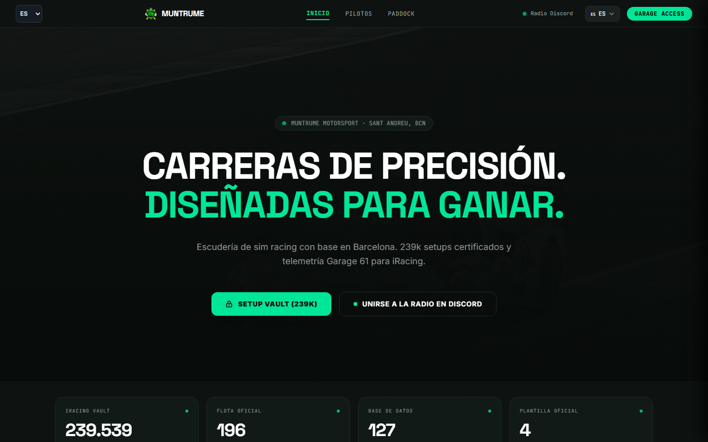
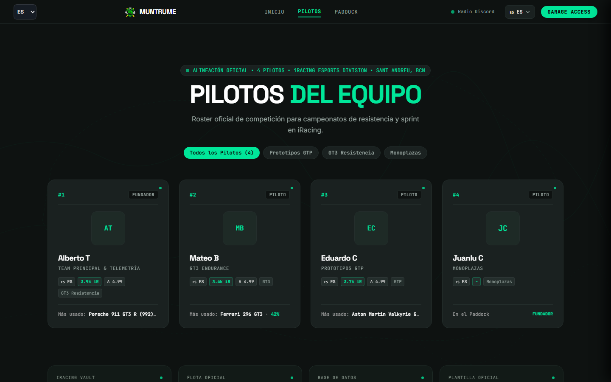
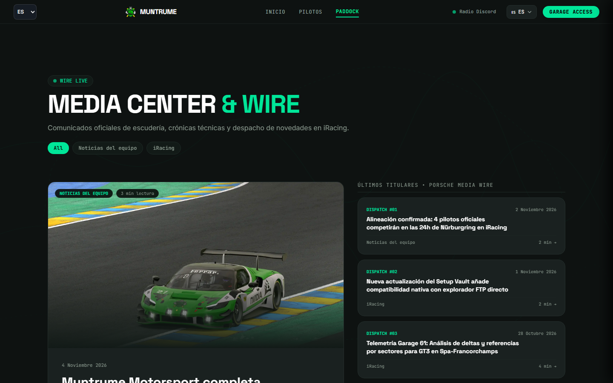
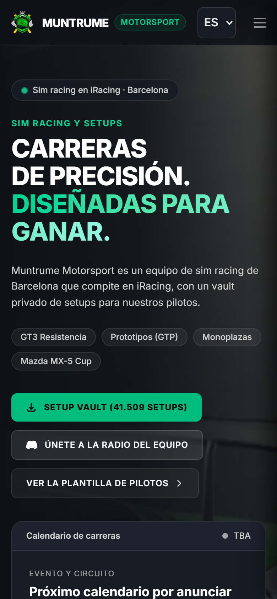
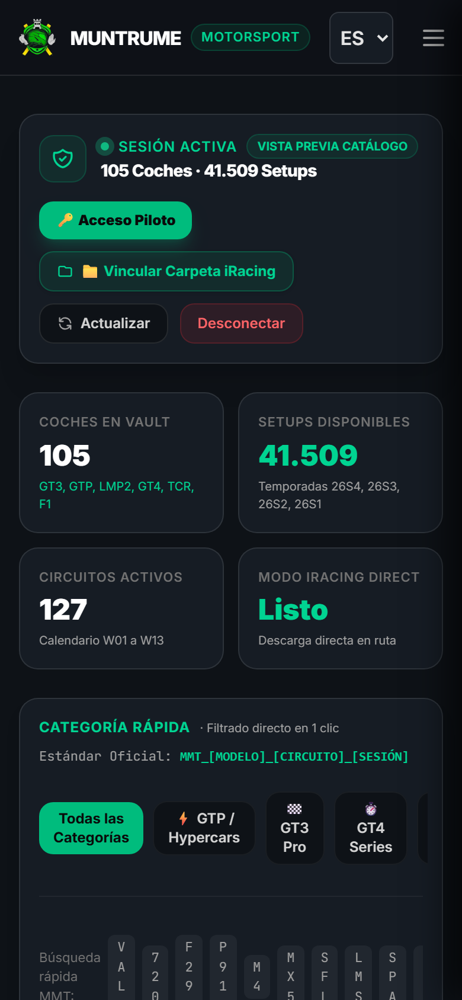
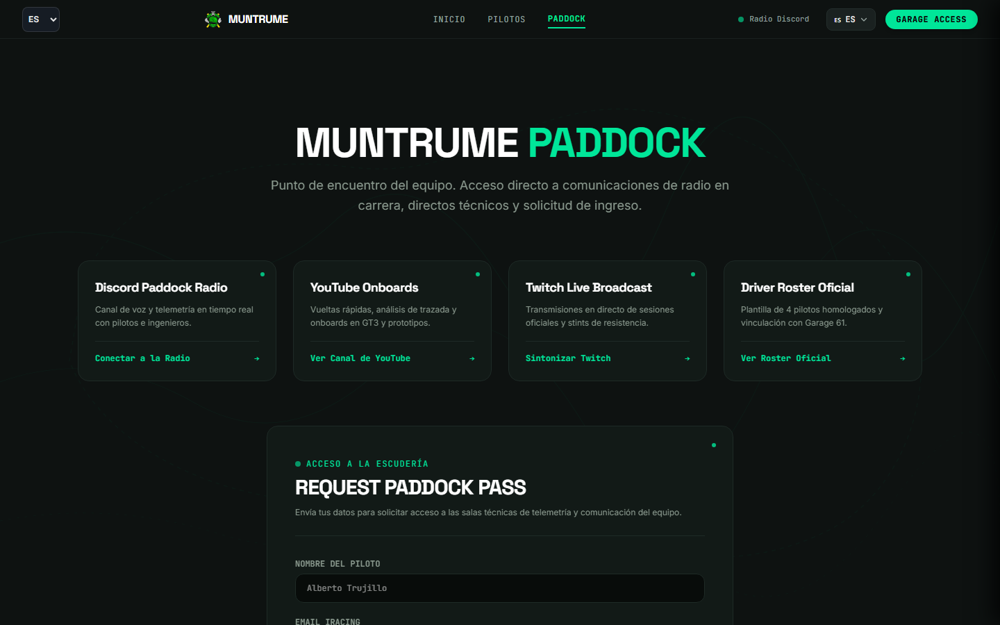

<p align="center">
  
</p>

<p align="center">
  <strong>Web oficial de Muntrume Motorsport, escudería de iRacing de Sant Andreu (Barcelona).</strong><br/>
  <em>Official website of Muntrume Motorsport, an iRacing sim-racing team from Barcelona (ES · EN · CA · FR).</em>
</p>

<p align="center">
  <a href="https://muntru.me"><b>muntru.me</b></a> ·
  <a href="https://muntru.me/pilotos/">Pilotos</a> ·
  <a href="https://muntru.me/news/">Noticias</a> ·
  <a href="https://muntru.me/paddock/">Paddock Pass</a> ·
  <a href="https://discord.gg/ehX6B8JUtE">Discord</a>
</p>

<p align="center">
  <a href="https://github.com/atrumin16/muntrume-site/actions/workflows/deploy.yml"></a>
  
  
  
  
</p>

---

## Capturas

| Pilotos | Noticias | Garage |
|:-:|:-:|:-:|
|  |  |  |

| Inicio (móvil) | Setups (móvil) | Contacto |
|:-:|:-:|:-:|
|  |  |  |

## Funciones

- **Paddock (público):** presentación del equipo, alineación con fichas por piloto, noticias de simracing con fuente y enlace al original, y solicitud de pruebas (*Paddock Pass*).
- **Garage (privado):** área para pilotos con sesión; los archivos de setup nunca se publican en este repositorio ni en la web estática.
- **Muntrume AI:** asistente de simracing integrado en la web, que se carga solo al abrirlo.
- **Cuatro idiomas:** español, inglés, catalán y francés, con `hreflang` y URLs canónicas.
- **Tema claro y oscuro** según el sistema o a elección del usuario.
- **Ligera y accesible:** imágenes AVIF/WebP con `srcset`, fuentes alojadas en el propio dominio, JS minificado y comprobación de accesibilidad con Lighthouse y axe.
- **Retirada de contenidos:** formulario en [/legal/retirada](https://muntru.me/legal/retirada/) para titulares de derechos.

## Stack

| Capa | Tecnología |
|---|---|
| Frontend | **Astro 7** · Tailwind CSS v4 · JavaScript sin framework en el cliente |
| Hosting | **GitHub Pages** (dominio propio `muntru.me`) |
| API | Servicio privado en **Cloudflare Workers** (código fuera de este repositorio) |
| Asistente IA | Trujillo AI |
| CI/CD | GitHub Actions con acciones fijadas por SHA · Dependabot |

> Este repositorio contiene **solo el frontend**. La API, su configuración y la auditoría interna viven en un repositorio privado.

## Desarrollo local

Requiere **Node.js 24** (el mismo que usa CI).

| Comando | Qué hace |
|---|---|
| `npm ci` | instala dependencias exactas |
| `npm run dev` | servidor de desarrollo de Astro |
| `npm run build` | CSS + build estático + minificado → `_site/` |
| `npx astro check` | comprobación de tipos y plantillas |

## CI, despliegue y vuelta atrás

- Cada *push* a `main` ejecuta `astro check`, construye el sitio y lo publica en GitHub Pages.
- Para volver atrás: `git revert <commit>` y *push*; Pages vuelve a desplegar la versión anterior.

## Estructura

```
src/
  pages/        rutas (inicio, pilotos, noticias, legal, garage…)
  components/   navegación, asistente IA y piezas comunes
  layouts/      plantilla base (SEO, CSP, tema)
public/assets/  CSS, JS, imágenes y fuentes
scripts/        utilidades de build y pruebas
```

## Seguridad

Consulta [SECURITY.md](SECURITY.md) para avisar de una vulnerabilidad de forma privada.

## Equipo

Mantenido por [@atrumin16](https://github.com/atrumin16) (Alberto Trujillo, Team Principal). ¿Quieres correr con nosotros? Pide tu [Paddock Pass](https://muntru.me/paddock/).

---

<p align="center">© 2026 Muntrume Motorsport · Sant Andreu, Barcelona</p>
