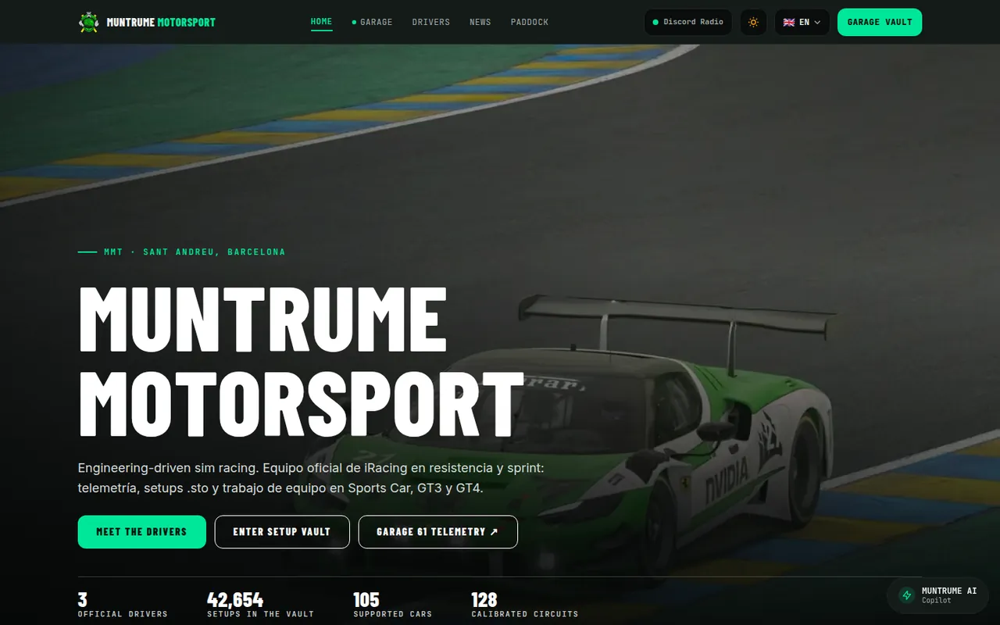
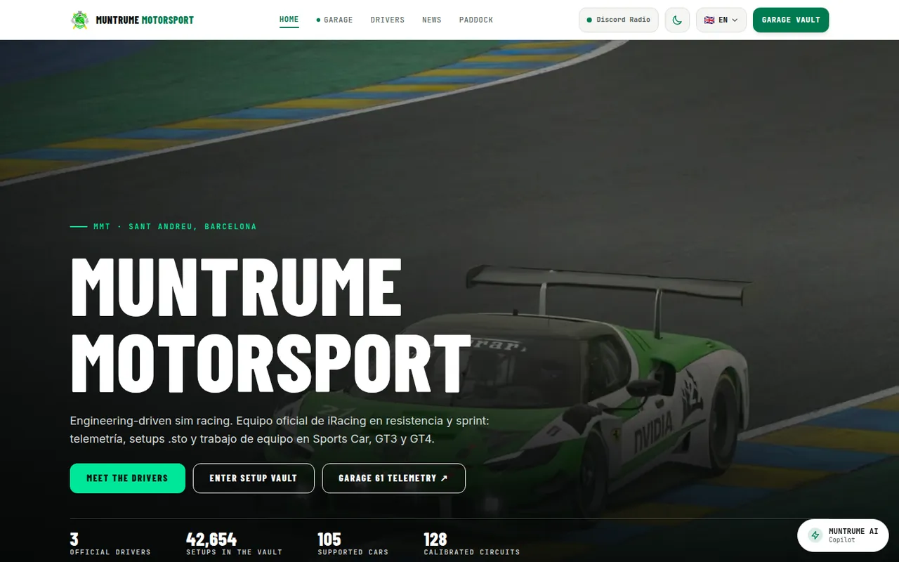
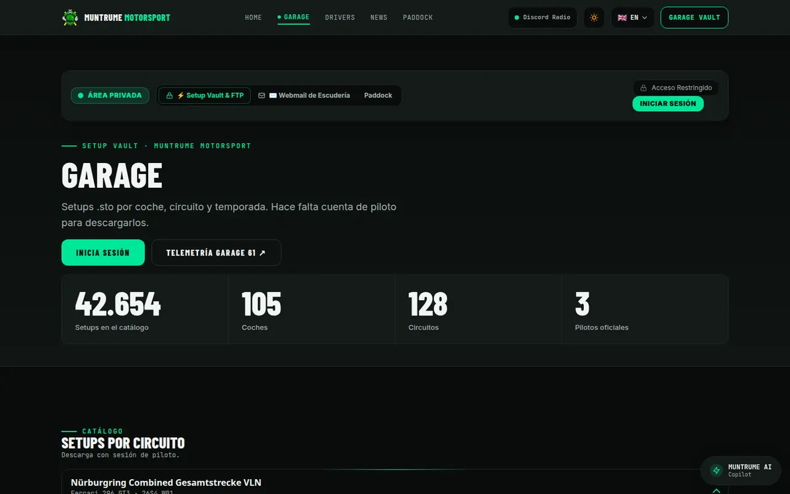
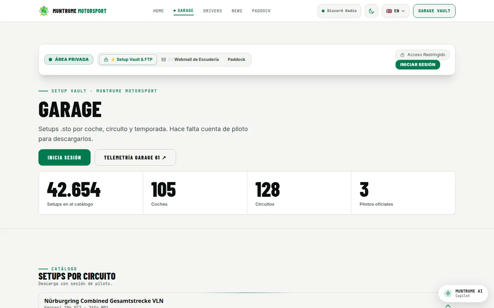

<p align="center">
  
</p>

<p align="center">
  <strong>Web oficial de Muntrume Motorsport (MMT), equipo de sim racing en iRacing de Sant Andreu, Barcelona.</strong><br/>
  <em>Official website of Muntrume Motorsport (MMT), an iRacing sim-racing team from Sant Andreu, Barcelona.</em>
</p>

<p align="center">
  <a href="https://muntru.me"><b>muntru.me</b></a> ·
  <a href="https://muntru.me/app/">MMT Sync</a> ·
  <a href="https://muntru.me/overlay/">HUD 60Hz</a> ·
  <a href="https://muntru.me/garage/">Garage (.sto)</a> ·
  <a href="https://muntru.me/ai/">Muntrume AI</a> ·
  <a href="https://muntru.me/calendar/">Calendario S4</a> ·
  <a href="https://muntru.me/pilotos/">Pilotos</a> ·
  <a href="https://muntru.me/paddock/">Paddock</a>
</p>

<p align="center">
  <a href="https://github.com/ATM-Software-Labs/muntrume-site/actions/workflows/deploy.yml"></a>
  <a href="https://github.com/ATM-Software-Labs/muntrume-site/actions/workflows/desktop-ci.yml"></a>
  
  
  
  
  
  <a href="LICENSE"></a>
</p>

---

## Capturas

Tomadas en [muntru.me](https://muntru.me).

| Inicio · oscuro | Inicio · claro |
|:-:|:-:|
|  |  |

| Garage · oscuro | Garage · claro |
|:-:|:-:|
|  |  |

## Ecosistema Muntrume Motorsport

- **Landing & Experiencia Visual:** Diseño estilo lanzamiento de hardware con pod de telemetría iRSDK en vivo a 60 FPS, Bento Grid interactivo, decodificador oficial de nomenclatura `.sto` (`MMT_COCHE_CIRCUITO_SESION_V#.sto`), motor de animaciones `motion.js` (`IntersectionObserver` con física spring + spotlight radial) y soporte completo para temas claro/oscuro y dispositivos móviles.
- **MMT Sync Desktop (`desktop/`):** Aplicación nativa para Windows en **Tauri v2 + Rust** (`< 15 MB RAM`, `0% GPU idle`) que sincroniza por SHA-256 más de **42.654 setups `.sto`** en `Documents\iRacing\setups\`, analiza telemetría `.ibt` en local, calcula estrategia de combustible/stints, detecta hardware DirectInput/XAudio2 y renderiza **9 módulos de Overlays transparentes a 60 Hz** (`FILE_MAP_READ`).
- **Garage & Setup Builder (`/garage/`, `/setup-builder/`):** Catálogo completo de archivos `.sto` por coche, circuito y temporada con diagnóstico interactivo de subviraje/sobreviraje.
- **Simulador Web de Overlays (`/overlay/`):** Previsualización interactiva en el navegador de los 9 widgets del HUD (Standings, Relative, Mapa Catmull-Rom, Pedales, Radar 360°, Fuel Calculator, Neumáticos, Delta y Spotter).
- **Muntrume AI (`/ai/` · [ai.muntru.me](https://ai.muntru.me/)):** Estudio de IA 100 % Open Source (MIT) con motores **Muntrume 1.0 Lite, Pro y Ultra Max**, comandos rápidos (`/setup`, `/strategy`, `/code`, `/slides`, `/doc`, `/mermaid`), visión por imagen, exportación de conversaciones `.md` y *Artifacts Studio* en pantalla dividida (HTML, SVG, Mermaid, Slides 16:9, CSV, Word `.doc` y PDF) con publicación permanente en `ai.muntru.me/a/<slug>`.
- **Calendario 2026 S4 & Store Planner (`/calendar/`):** Planificador de las 12 semanas oficiales de iRacing con calculadora de Participation Credits y descuentos por volumen.
- **Pilotos, Noticias, Paddock y Wallpapers 4K (`/pilotos/`, `/noticias/`, `/paddock/`, `/wallpapers/`):** Plantilla oficial con telemetría de Garage 61, sala de prensa y packs de fondos 16:9 / 9:16 con sincronizador multi-monitor `0 ms`.

## Documentación Interna y Descubrimiento IA

| Recurso | Descripción |
|---|---|
| [docs/README.md](docs/README.md) | Índice central de la documentación técnica interna |
| [docs/ARCHITECTURE.md](docs/ARCHITECTURE.md) | Arquitectura del ecosistema (`muntru.me`, `ai.muntru.me`, D1 y MMT Sync) |
| [docs/AI_STUDIO.md](docs/AI_STUDIO.md) | Referencia interna de Muntrume AI Studio, Markdown y Artifacts |
| [docs/SEO_AND_LLMS.md](docs/SEO_AND_LLMS.md) | Guía de SEO, JSON-LD y ficheros para IAs externas |
| [docs.muntru.me](https://docs.muntru.me/) | Documentación pública oficial de Muntrume |
| [llms.txt](public/llms.txt) · [ai-knowledge.json](public/ai-knowledge.json) · [ai-openapi.json](public/ai-openapi.json) | Especificaciones legibles por buscadores, agentes RAG e IAs externas |

## Stack

| Capa | Tecnología |
|---|---|
| Web Frontend | Astro 7 · TypeScript · Tailwind CSS 4 · Canvas 60 FPS |
| Desktop App (`desktop/`) | Tauri v2 · Rust (`mmt-sync`, `mmt-sync-core`) · Windows iRSDK Shared Memory |
| Sitio estático | HTML estático en `_site/` con compresión Brotli/Gzip y CSP estricta |
| Hosting & API | **GitHub Pages** (`muntru.me`) + Cloudflare Workers API |
| CI / CD | GitHub Actions (`deploy.yml`, `desktop-ci.yml`, `desktop-release.yml`) |

## Estructura del Repositorio

```
src/pages/            landing, app, overlay, garage, setup-builder, ai, calendar, pilotos, paddock, wallpapers, noticias
src/components/       navegación, fichas de piloto, chatbot IA, calculadora de combustible y modales
src/layouts/          documento base, JSON-LD SEO, temas claro/oscuro y barra de progreso
src/lib/              catálogo del garage, pilotos, telemetría y utilidades
public/assets/        CSS (racing.css, mobile.css), motor de animaciones (motion.js), i18n y catálogo
desktop/              cliente nativo MMT Sync para Windows (Tauri v2 + Rust + TypeScript)
  ├── core/           crate Rust mmt-sync-core (hashing SHA-256, rutas seguras, parser .ibt, combustible)
  ├── src-tauri/      binario Rust Tauri v2 (iRSDK 60Hz, puente local 127.0.0.1:38421, bandeja, Credential Manager)
  └── src/            interfaz del Centro de Mando MMT, HUD Studio y analizador de sesiones
scripts/              generación de sitemap, sincronización de calendarios y optimización del build
docs/                 documentación técnica, contratos de API y capturas
.github/workflows/    CI/CD de la web estática y compilación de instaladores Windows (.exe / .msi)
```

## Desarrollo local

El workflow de deploy usa **Node.js 24**.

```bash
git clone https://github.com/ATM-Software-Labs/muntrume-site.git && cd muntrume-site
npm ci
npm run dev
```

| Comando | Qué hace |
|---|---|
| `npm ci` | Instala las dependencias del lockfile |
| `npm run dev` | Servidor de desarrollo de Astro |
| `npm run check` | `astro check`: tipos y componentes |
| `npm run build` | CSS, sitio estático, sitemap, minificado y compresión. Salida en `_site/` |

## Despliegue

Cada push a `main` lanza [Deploy Static Site to GitHub Pages](.github/workflows/deploy.yml): `npm ci`, `npm run check`, `npm run build` y publicación de `_site/` en GitHub Pages. También se puede lanzar a mano (`workflow_dispatch`) y hay una republicación programada. El dominio `muntru.me` sale de `public/CNAME`.

Para volver atrás: `git revert <commit>` y push a `main`, que vuelve a desplegar. También se puede restaurar un despliegue anterior del entorno `github-pages`.

## Enlaces

- [Discord](https://discord.gg/ehX6B8JUtE)
- [Garage 61](https://garage61.net/app/teams/muntrume-motorsport)

## Contribuir

Las plantillas de issue y de pull request están en `.github/`. Antes del PR, ejecuta `npm run check` y `npm run build`. Si encuentras una vulnerabilidad, sigue [.github/SECURITY.md](.github/SECURITY.md) en lugar de abrir un issue público.

## Instalación de MMT Sync (Windows)

Puedes instalar MMT Sync de dos formas:

1. **Instalación recomendada mediante Windows Package Manager (winget):**
   Si al descargar el instalador directo te aparece el aviso de Windows SmartScreen («editor desconocido») y no estás seguro de ejecutarlo, la alternativa oficial y segura es instalarlo desde la terminal mediante **winget**:
   ```powershell
   winget install Muntrume.MMTSync
   ```
   *(Valida automáticamente el hash SHA-256 oficial del paquete).*

2. **Descarga directa:**
   Descarga el instalador ejecutable `.exe` o paquete `.msi` desde [muntru.me/app/](https://muntru.me/app/) o desde [Releases](https://github.com/ATM-Software-Labs/muntrume-site/releases/latest).

## Licencia

[MIT](LICENSE) © 2026 Alberto Trujillo Mingorance / Muntrume Motorsport · [Aviso Legal](docs/LEGAL.md) · [Marcas registradas](docs/TRADEMARKS.md). Fuentes autoalojadas bajo [SIL OFL 1.1](public/assets/fonts/OFL.txt).
