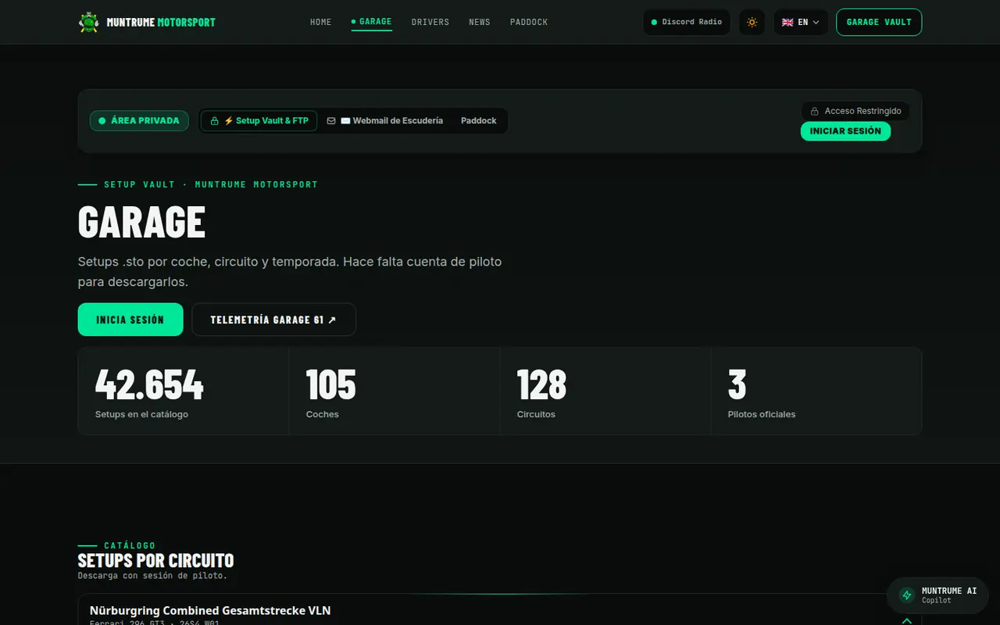
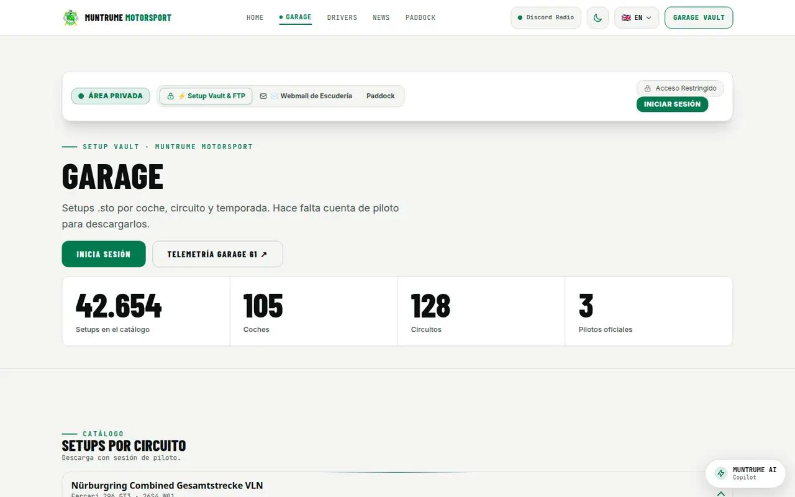

<p align="center">
  
</p>

<p align="center">
  <strong>Web oficial de Muntrume Motorsport (MMT), equipo de sim racing en iRacing de Sant Andreu, Barcelona.</strong><br/>
  <em>Official website of Muntrume Motorsport (MMT), an iRacing sim-racing team from Sant Andreu, Barcelona.</em>
</p>

<p align="center">
  <a href="https://muntru.me"><b>muntru.me</b></a> ·
  <a href="https://muntru.me/garage/">Garage</a> ·
  <a href="https://muntru.me/pilotos/">Pilotos</a> ·
  <a href="https://muntru.me/noticias/">Noticias</a> ·
  <a href="https://muntru.me/paddock/">Paddock</a>
</p>

<p align="center">
  <a href="https://github.com/atrumin16/muntrume-site/actions/workflows/deploy.yml"></a>
  
  
  
  
  <a href="LICENSE"></a>
</p>

---

## Capturas

Tomadas en [muntru.me](https://muntru.me).

| Inicio · oscuro | Inicio · claro |
|:-:|:-:|
|  |  |

| Garage · oscuro | Garage · claro |
|:-:|:-:|
|  |  |

## Funciones

- **Pilotos y fichas:** la plantilla pública está en `/pilotos/` y `/drivers/`. Cada piloto tiene su ficha.
- **Garage y setups:** `/garage/` lista los archivos `.sto` por coche, circuito y temporada. La descarga pide cuenta de piloto.
- **Paddock:** `/paddock/` reúne los enlaces del equipo, incluida la radio y la telemetría.
- **Noticias:** la sala de prensa vive en `/noticias/`. `/news/` redirige ahí.
- **Tema claro y oscuro:** la preferencia se guarda en el navegador. Si no hay ninguna, se usa `prefers-color-scheme`.
- **SEO:** título y descripción por página, URL canónica, `hreflang` (inglés, español, catalán y francés), Open Graph y un sitemap que genera el build.

## Stack

| Capa | Tecnología |
|---|---|
| Frontend | Astro 7 · TypeScript · Tailwind CSS 4 |
| Sitio | HTML estático en `_site/` |
| Hosting | **GitHub Pages** · [muntru.me](https://muntru.me) (`public/CNAME`) |
| CI | GitHub Actions · `.github/workflows/deploy.yml` |

## Estructura

```
src/pages/            inicio, pilotos, garage, paddock, noticias
src/components/       fichas, navegación y piezas del garage
src/layouts/          documento, SEO y tema
src/lib/              pilotos y catálogo del garage
src/styles/           tokens y Tailwind
public/               imágenes, i18n, catálogo público y CNAME
scripts/              sitemap, minificado y compresión del build
docs/                 banner y capturas de este README
.github/workflows/    deploy a GitHub Pages
```

## Desarrollo local

El workflow de deploy usa **Node.js 24**.

```bash
git clone https://github.com/atrumin16/muntrume-site.git && cd muntrume-site
npm ci
npm run dev
```

| Comando | Qué hace |
|---|---|
| `npm ci` | Instala las dependencias del lockfile |
| `npm run dev` | Servidor de desarrollo de Astro |
| `npm run check` | `astro check`: tipos y componentes |
| `npm run build` | CSS, sitio estático, sitemap, minificado y compresión. Salida en `_site/` |

## Despliegue

Cada push a `main` lanza [Deploy Static Site to GitHub Pages](.github/workflows/deploy.yml): `npm ci`, `npm run check`, `npm run build` y publicación de `_site/` en GitHub Pages. También se puede lanzar a mano (`workflow_dispatch`) y hay una republicación programada. El dominio `muntru.me` sale de `public/CNAME`.

Para volver atrás: `git revert <commit>` y push a `main`, que vuelve a desplegar. También se puede restaurar un despliegue anterior del entorno `github-pages`.

## Enlaces

- [Discord](https://discord.gg/ehX6B8JUtE)
- [Garage 61](https://garage61.net/app/teams/muntrume-motorsport)

## Contribuir

Las plantillas de issue y de pull request están en `.github/`. Antes del PR, ejecuta `npm run check` y `npm run build`. Si encuentras una vulnerabilidad, sigue [SECURITY.md](SECURITY.md) en lugar de abrir un issue público.

## Licencia

[MIT con exclusión de marca](LICENSE) © 2026 Alberto Trujillo Mingorance / Muntrume Motorsport. Fuentes autoalojadas bajo [SIL OFL 1.1](public/assets/fonts/OFL.txt).
