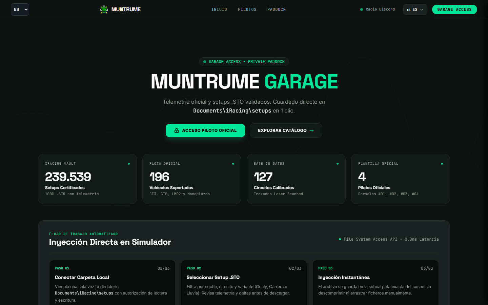

# MUNTRUME MOTORSPORT
### Sant Andreu, Barcelona — iRacing Sim Racing Team

> **PRECISION RACING. ENGINEERED TO WIN.**

Escudería independiente de iRacing con base en Sant Andreu, Barcelona. 4 pilotos oficiales, 196 coches y 239.539 setups validados con telemetría Garage 61 y MoTeC i2 Pro.

**[ Web - muntru.me ](https://muntru.me) | [ Garage Access ](https://muntru.me/garage) | [ Paddock ](https://muntru.me/paddock) | [ Discord ](https://discord.gg/ehX6B8JUtE)**

---

### Platform Showcase

<p align="center">
  
</p>

<p align="center">
  <em>Home — Hero limpio, stats unificados y acceso directo al Garage</em>
</p>

---

### Official Lineup 2026

4 pilotos homologados para GTP, GT3 Endurance y Monoplazas.

<p align="center">
  
</p>

| # | Piloto | Rol | Especialidad |
| :--- | :--- | :--- | :--- |
| **#1** | **Alberto Trujillo** | Team Principal & Telemetría | Dinámica vehicular, análisis 60Hz |
| **#2** | **Mateo Berbis** | Lead Sprint & Qualy | Vuelta rápida, clasificación |
| **#3** | **Eduardo Chongkan** | Race Engineer & Prototipos | Curvas rápidas, resistencia |
| **#4** | **Juanlu Carrillo** | Monoplazas Specialist | Alta carga aerodinámica, Formula |

---

### Estructura: Paddock + Garage

Hemos simplificado 7 páginas en 2 conceptos.

#### 1. MUNTRUME PADDOCK — El Club (Público)

<p align="center">
  
  
</p>

Donde entra todo el mundo. Manifiesto del equipo, canales oficiales y solicitud de ingreso.

- **Discord:** Radio oficial del equipo
- **YouTube:** @jostrume18gameplays28 — Onboards y análisis
- **Twitch:** muntrumemrt — Live stints
- **Request Paddock Pass:** Formulario de ingreso en /paddock

#### 2. MUNTRUME GARAGE — Área Privada (Solo Pilotos)

<p align="center">
  
</p>

<p align="center">
  <em>Setup Vault — 239.539 setups con guardado en 1 clic en Documents\iRacing\setups</em>
</p>

<p align="center">
  
</p>

<p align="center">
  <em>Team Comms — Buzón privado, telemetría .STO y MoTeC i2 Pro</em>
</p>

La central de ingeniería del equipo.

- **Setup Vault:** 239.539 setups organizados por temporada, semana y circuito
- **Guardado 1-Click:** Directo a tu carpeta local `Documents\iRacing\setups\[coche]\...` sin mover archivos a mano
- **Telemetría Garage 61:** Vueltas rápidas, referencias de frenada y deltas
- **Team Comms:** Buzón privado y cifrado para cada piloto de la escudería
- **Single Sign-On:** Un solo login para Vault + Comms + Telemetría

---

### Stats Unificados

4 números fijos en toda la web. Una sola fuente de verdad.

| Stat | Número | Detalle |
| :--- | :--- | :--- |
| **Setups Certificados** | **239.539** | Firmados con marca oficial MMT, telemetría y variantes Q/R/Wet |
| **Vehículos iRacing** | **196** | GT3, GTP Hypercars, LMP2, LMP3, Formula, MX-5 y TCR |
| **Circuitos Calibrados** | **127** | Laser-scanned con datos de clima y goma en pista |
| **Pilotos Oficiales** | **4** | Plantilla cerrada con dorsales #1, #2, #3 y #4 |

---

### Funciones Pro del Garage

#### Guardado Directo a iRacing en 1 Clic

El sistema usa la **File System Access API** del navegador para escribir directamente en tu disco local.

```
Tu Click en muntru.me
  -> File System API
    -> Documents\iRacing\setups\[coche]\Garage 61 - Muntrume Motorsport\...
      -> Archivo .STO listo en el simulador
```

Sin descomprimir zips, sin copiar y pegar carpetas, sin reiniciar iRacing.

#### Variantes de Setup por Carrera

Cada combo de coche + circuito incluye:
- **Qualy (Q):** Máxima carga, mapa motor agresivo, combustible para 2 vueltas
- **Race (R):** Balance estable, desgaste de neumáticos optimizado, tanque lleno
- **Wet:** Altura aumentada, mapa de acelerador suave, presiones de lluvia

---

### Press Room & Media Wire

<p align="center">
  
</p>

Wire en vivo conectado a RSS públicos de iRacing, Sim Racing y Motorsport. Team updates y titulares oficiales.

---

### Mobile First — 100% Responsive

Diseñado para 375px, 390px y 412px. 40px touch targets, scroll chips y cero overflow.

<p align="center">
  
  
  
</p>

---

### ¿Cómo empiezo?

**Si eres fan:**
1. Entra al Paddock en Discord: discord.gg/ehX6B8JUtE
2. Sigue el calendario en muntru.me

**Si quieres ser piloto:**
1. Ve a muntru.me/paddock
2. Rellena Request Paddock Pass con tu nombre, email de iRacing e iRating
3. Te respondemos en < 24h con test de ritmo

**Si ya eres piloto oficial:**
1. Ve a muntru.me/garage
2. GARAGE ACCESS con tu email de piloto
3. Acceso total a Vault + Comms + Telemetry

---

<details>
<summary><b>Technical Stack (para devs)</b></summary>

| Layer | Tech |
| :--- | :--- |
| Frontend | Astro 5 + Tailwind 4 — SSG |
| Edge | Cloudflare Workers — Zero-Trust |
| DB | Cloudflare D1 — muntrume_vault |
| Email | Cloudflare Email Routing + Resend + PostalMime |
| Hosting | GitHub Pages Edge CDN |
| QA | Playwright E2E Mobile Audit |

Arquitectura: GitHub Pages -> Cloudflare Worker (Auth + Mail) -> D1 + Email Routing. Zero-Trust: PBKDF2 100k + HMAC 2FA 10m + HSTS preload + CSP frame-ancestors none.

</details>

---

**Muntrume Motorsport © 2026 — SimRacing Team — Sant Andreu, Barcelona, CAT — muntru.me**
**iRacing Sim Racing Team — GT3 Endurance | Prototypes GTP | Single-Seater — Discord: ehX6B8JUtE**
